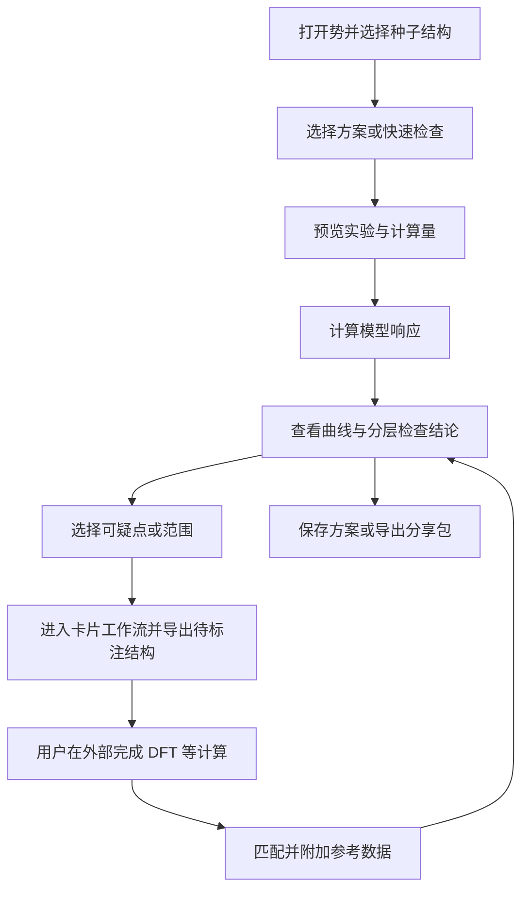

# 势函数验证与诊断工作台：完整方案

- 日期：2026-10-23
- 状态：阶段 A 已在当前分支实现并完成本地验证，未提交；阶段 B / C 保留为设计
- 现有实现基线：`model-validation-workflow`，`6bb6be46`
- 适用范围：晶格、磁性及磁弹耦合的静态诊断、参考验证和补充采样闭环。

本文用于产品讨论、开发拆分和验收。“阶段 A 本次实现”小节记录已经完成的范围，其余新增数据契约及阶段 B / C 能力仍为拟议设计。不修改或取代训练集评估模块的既有设计；本工作台负责模型响应与性质实验，训练集评估负责数据质量、分布和覆盖证据。

## 1. 产品定位与设计决定

继续使用现有的势函数工作台，将当前“验证”页扩展为“验证与诊断”。用户没有 DFT 数据时，可以从一个结构出发，对势函数做受控实验；有 DFT、实验测量或其他可信参考时，可以在同一实验中进一步比较。

功能需要回答四个问题：

1. 模型的能量、力、应力和磁响应是否自洽？
2. 在指定结构和条件附近，模型预测了怎样的响应？
3. 哪些变化值得核实，哪些与已知约束或参考数据冲突？
4. 下一步该检查哪些结构、补哪些计算，如何把它们送入现有卡片工作流？

已经确定的设计方向：

- 总入口保留在现有工作台及其顶部菜单，不为每种性质在 show_nep 增加入口。
- 没有参考数据是合法、完整的使用场景，不能用“请先导入 DFT”阻断诊断。
- 同一个实验可逐步增加参考证据，不拆成两套互不兼容的功能。
- 晶格、磁性和耦合实验共享方案、任务、比较、分享与补充采样机制。
- 打开模型不自动入库。首次探索可临时运行，保存时再选择项目和名称。
- 同一个势可关联多个项目；项目负责组织，方案负责定义重复实验。
- 不生成一个不透明的综合“可靠性分数”，也不因所有检查通过就宣布模型可靠。
- 优先复用现有 NumPy、SciPy、ASE 和结构生成能力，不新增必需的运行依赖。

首版不包含完整声子谱、完整弹性张量、长时间动力学、居里温度预测、自动 DFT 提交，以及自动训练或替换模型。

## 2. 现有基础与需要改变的地方

### 2.1 已有能力

当前分支已经具备：

- 项目、已保存势快照和临时势验证；
- 固定验证方案与参考基准集；
- EOS 分组导入、参考曲线预览和多势比较；
- 小图网格、图例隐藏、放大和视图重置；
- 一个方案内的单一基准势版本；
- EOS 可疑范围进入卡片工作流，生成和导出结构；
- `.ntkpack` 分享包，支持可选势文件、导入预览和新建方案保护；
- 磁性响应结构生成及分组元数据，包括局部旋转、磁矩幅值、磁纹理和磁弹扫描。

这些是复用基础，但现有磁性分组审计主要检查扫描完整性和结构约定，不等于已经完成模型磁响应诊断。

### 2.2 不能直接沿用的假设

目前 EOS 和通用能量／力／virial 验证的输入以带参考标签的结构为中心；分享包也按参考 EXTXYZ 数据集检查内容。界面的性质名称、指标列和结果面板仍有 EOS／EFV 分支。

本次改造需解除以下限制：

| 现有假设 | 目标行为 |
|---|---|
| 输入必须具有参考能量等标签 | 结构和实验条件充分时即可计算响应；标签按检查需要读取 |
| 主要结果是预测与参考的误差 | 响应、数值检查、物理预期和参考比较分别呈现 |
| 一个参考数据集代表一个计算任务 | 一个实验包含种子、实际扫描输入、参数、可选参考及检查规则 |
| 改善／退化主要来自相对基准势的误差 | 只有具有明确方向和可比较依据的指标才标改善／退化 |
| 分享内容主要是一份参考结构文件 | 可分享无标签实验、必要附件和检查条件 |

不能通过给无标签结构填零能量、伪造 DFT 标签或跳过所有输入检查来实现兼容。

## 3. 用户场景与成功标准

| 场景 | 用户已有内容 | 用户希望获得的结果 |
|---|---|---|
| 新势快速体检 | 势文件、一个或少量结构 | 看出是否存在自洽性问题，并获得几条直观响应曲线 |
| 每代势比较 | 固定方案、历史版本 | 知道哪种结构、哪段扫描发生变化，以及是否有证据支持进退步判断 |
| 没有 DFT 的探索 | 结构、目标条件或经验预期 | 定位可疑区域，导出少量值得核实的结构 |
| 后补参考数据 | 已运行实验、返回的 DFT 结果 | 可靠匹配结构，增加参考比较，保留之前的诊断历史 |
| 合作分享 | 方案、可选势文件 | 对方无需原机器路径即可重复实验 |

核心验收故事：打开新势，选择一个无标签结构，运行晶格或磁性实验，定位可疑区间，进入卡片工作流导出待标注结构；拿到 DFT 后回到同一实验，完成匹配和参考比较。

成功意味着这条路径完整、条件可追溯、结论不混淆。曲线漂亮或测试通过本身不构成科学验收。

## 4. 核心概念

### 4.1 方案、实验、参考与基准势

| 概念 | 含义 | 用户需要知道的行为 |
|---|---|---|
| 方案 | 一组可重复运行的实验 | 可保存、复用、分享；允许同时包含晶格和磁性实验 |
| 实验 | 种子结构、扰动、扫描点和计算条件 | 每次模型比较使用同一实验版本 |
| 参考证据 | DFT 标签、实验值或有条件说明的外部数据 | 可选，记录来源类别、单位和适用条件 |
| 物理预期 | 用户或模板声明的检查条件 | 与实测参考区分，可关闭；不得伪装成参考值 |
| 对比势 | 本次一起运行或展示的多个模型 | 可以隐藏曲线，隐藏不改变计算任务 |
| 基准势 | 方案内选定的一个历史模型 | 用于版本比较，不自动具有真值地位 |
| 运行 | 某个模型在某个实验版本上的计算记录 | 模型内容、后端和计算条件可追溯 |

“实验”是内部统一概念。界面应优先显示“体积扫描”“局部位移”“磁矩旋转”等用户熟悉的名字。

### 4.2 一个实验的组成

一个实验至少保存：

- 种子结构及其来源信息；
- 晶胞、元素、原子对应关系、周期边界和需要时的输入磁矩；
- 扫描对象、坐标定义、实际采样点和单位；
- 哪些自由度固定、哪些自由度允许弛豫；
- 生成器和计算协议版本；随机生成时的种子；
- 实际生成结构的内容指纹和对应扫描点；
- 可选的参考证据、物理预期与检查规则。

保存可复现实验时同时保存实际生成结构，不能仅靠随机种子和参数承诺跨版本复现。

## 5. 端到端流程



### 5.1 从 show_nep 开始

用户通过现有总入口进入工作台，带入当前势及当前选中的结构。默认只带入明确选择的结构，避免将整个训练集自动扩展成大批任务。

没有选中结构时，在工作台提示选择或导入种子；不自动选择某个原子数最小的结构冒充代表结构。没有模型时仍可编辑实验、预览结构和已有参考，只禁用模型运行。

### 5.2 选择方案或快速检查

方案选择器提供“临时方案”，快速检查提供四类入口：基础一致性、晶格响应、磁性响应、磁弹响应。界面可按问题组织，不增加四个独立主页面。

按后端实际能力显示可用检查。只输出能量的模型可以做能量扫描，但无法做解析力一致性检查。模型名称或文件头只能提供部分信息，不能据此猜测 SOC、外场和磁矩单位等全部约定。

能力不足标为“不支持”，适用条件未知标为“待确认／不适用”，不能显示为计算失败或静默跳过。

### 5.3 配置与预览

默认显示种子、扫描对象、范围、点数、固定条件；高级参数折叠。预览显示结构数量、原子数范围、所选模型数和预计预测调用量。

未经过代表性测量时不承诺精确完成时间。数量超过预设交互预算时，明确展示扩展规模，由用户通过正常“运行”动作启动；不得在更改参数或打开页面时自动执行。

参数改变立即使旧预览失效；异步返回的旧预览不得覆盖新参数。取消、切换种子、切换库或清空输入时取消或丢弃过期任务。

临时实验先固定输入几何和指定磁矩，避免不同势各自弛豫后混淆比较。弛豫模式以后独立提供，记录约束、收敛阈值、优化器和最终结构；不得在某个模型失败时自动换模式。

### 5.4 运行与结果

沿用“验证所选版本”的批量操作，名称可调整为“运行所选版本”，覆盖没有参考数据的情况。运行状态按实验和模型分别记录，单项失败不抹掉其他结果。

取消后保留已经完成的子任务；未完成项显示取消或未运行，不能当作零值。再次运行复用条件完全一致的有效缓存，并允许明确重算。

### 5.5 附加参考数据

从结果页选择“添加参考数据”，预览匹配结果后附加。结构匹配以稳定身份和内容核对为主，不能只按文件顺序或浮点扫描坐标关联。

每个数据点标为已匹配、缺失、重复、冲突或待人工映射。部分参考数据是合法状态，只在匹配子集上计算误差，并显示覆盖点数和区间。

若 DFT 计算改变了结构、晶胞、原子顺序或磁矩状态，应检查是否仍是同一实验条件。弛豫后的结构不能直接覆盖原先的固定结构参考；需要新建派生实验或明确的重新映射。受约束磁性计算还需保留实际最终磁矩与目标磁矩的区别。

添加或替换参考数据生成新参考版本，保留原有记录。几何和模型未变时，优先复用模型预测，仅重新做比较和检查。

## 6. 页面布局与交互

拟议布局：

```text
顶部全局菜单：打开 ▾   保存 ▾                     跟随当前页面

验证与诊断 | 项目

方案 [HEA 检查 ▾]     当前势 [新版本 ▾]     对比势 [多选 ▾]
基准势：上一代       参考覆盖：部分实验有参考       [运行所选版本]

实验导航／筛选：全部 · 基础一致性 · 晶格 · 磁性 · 耦合
┌ 体积扫描 ────────────┐ ┌ 局部旋转 ────────────┐
│ 模型曲线及可选参考   │ │ 能量／转矩响应       │
│ 范围、单位、检查摘要 │ │ 适用条件、检查摘要   │
│ 放大／重置／送至卡片 │ │ 放大／重置／送至卡片 │
└──────────────────────┘ └──────────────────────┘

[可疑项 3]   [检查详情 ▸]   [参数与参考 ▸]
```

交互要求：

- 导入、保存、收藏和分享继续使用顶部菜单，不挤占底部绘图区。
- 顶部“保存到项目”与“保存方案”必须明确命名；主按钮跟随当前可保存对象，菜单中始终区分模型与方案。
- 即使未加载模型，保存方案和分享方案仍可用；不能因为保存势按钮禁用而封死整个下拉菜单。
- 同类实验默认小图网格；不同物理量不共用没有意义的纵轴。统一图例管理模型，参考值使用独立样式。
- 小图放大后有明显“返回网格”和“重置视图”；拖动选择范围与坐标缩放使用明确模式，避免手势冲突。
- 曲线点可以查看结构和原始数值；缺失或失败点显式标记，绘图不跨过缺失点制造连续性。
- 经验预期、参考曲线和模型预测使用不同图例语义，不靠颜色区分全部信息。
- 收藏和切换图例仅更新局部状态，不重算、不重建全部图形、不重置视角。
- 新增和编辑实验使用页面内编辑区域或侧面板；分享预览可复用现有弹窗。采样生成继续进入卡片模块。
- 窄窗口通过折行、折叠次要操作和滚动实验区适配，不把表格无限横向展开。

实际菜单文案及布局需在界面原型阶段确认，不在本草案中将其当作已实现行为。

## 7. 结果表达与判断规则

### 7.1 三层结果，四种检查结论

每张实验卡片分开呈现：

1. **模型响应**：计算得到的曲线、导数、残余力或磁力、局部曲率。
2. **检查结论**：满足条件时的通过／失败；数据不足时的无法判断；不适用时的原因。
3. **参考比较**：与匹配参考的差异；没有参考时明确显示“外部准确性未验证”。

任务状态另行记录为排队、运行、完成、失败、取消，不能与检查结论共用一个状态字段。任务计算完成但某项一致性检查失败，是正常可表示的情况。

### 7.2 可疑项的最小内容

每个可疑项必须回答：

- 观察到了什么，发生在哪些实验点、结构或原子上？
- 使用了什么规则，阈值和适用条件是什么？
- 是否经过步长或其他数值敏感性复核？
- 目前能够判断到哪一步，还有哪些替代解释？
- 可以采取什么动作：查看结构、局部加密、修改假设、附加参考或送至卡片？

示例文案仅表示展示方式，不代表实测结果：

> 在本次压缩范围内，模型出现第二个能量极小值；减小采样间隔后仍可观察到。目前没有匹配参考，无法判断它是真实相变分支还是模型异常。可以检查结构和局部应力，并导出附近结构进行参考计算。

### 7.3 规则等级

| 类别 | 依据 | 允许的结论 |
|---|---|---|
| 输入合法性 | 必需数据、单位、映射、有限值 | 可阻止运行；给出具体修复项 |
| 数值自洽性 | 导数、重复性、适用的对称关系 | 在声明条件和容差下通过／失败 |
| 模型行为 | 极值、局部曲率、磁序或结构变化 | 描述预测行为；不能自动宣判物理错误 |
| 用户预期 | 指定相／磁序／区间内的稳定性等 | 符合或冲突；必须展示前提 |
| 外部参考 | 匹配的 DFT、实验或其他独立数据 | 给出偏差、覆盖范围和参考限制 |
| 模型间分歧 | 多个模型的相同实验结果 | 标为待核实信号，不解释为校准后的误差或置信区间 |

没有被声明为应稳定的状态，出现负曲率不自动报模型错误；也不把稳定状态的经验范围跨成分、晶相、温度或磁态套用。

## 8. 实验与科学契约

### 8.1 基础一致性

首批提供原子力有限差分检查、按能力启用的应力检查、磁转矩检查，以及适用的平移／重排／旋转／时间反演检查。

计算导数时使用总能量，不能将用于绘图的每原子能量或平移后的曲线直接代入导数。所有矢量、张量都按对应变换比较，不能只比较数值列表是否相同。

- 原子力：以坐标正负扰动的总能量差检查对应力分量，记录步长和单位。
- 应力：明确应变定义、体积、应力／virial 的符号和分量顺序；先核对预测后端契约，再实现比较。
- 磁转矩：以固定幅值的角度扰动比较能量导数和磁力导出的广义力。角度求导统一使用弧度，图上可以显示度。
- 磁矩幅值：只对支持连续幅值变化、单位明确的模型启用。单位自旋和以 μB 表示的磁矩不得直接混用。
- 各项有限差分采用多步长检查，使用绝对与相对容差组合；接近零的量不能仅使用相对误差。

具体默认步长和阈值需由支持的后端、精度与代表性模型验收确定。本草案不写未经标定的通用数值。

自洽性通过只说明给定模型输出之间一致，并不证明能量面准确。ASE 的有限差分接口可作为普通原子力／应力实现的参考，磁性检查需核对磁力定义后单独实现。[来源 1]

### 8.2 对称性的适用条件

- 平移检查同时遵守周期边界和坐标约定。
- 原子重排时连同磁矩、约束和映射重排，输出恢复原顺序后比较。
- 刚体空间旋转需同步变换晶胞、位置、磁矩以及存在的外部方向条件。
- 自旋独立整体旋转只用于不存在 SOC、偶极等方向耦合并满足相应条件的模型。
- 整体磁矩反向检查要求物理设定具有对应时间反演对称性；外场等破坏条件存在时不能直接使用零场规则。
- 含 SOC 时单独旋转自旋产生磁各向异性能是允许的行为。

自旋是轴矢量；首版不通过简单反射坐标扩大为所有空间变换测试。涉及反射的测试需正确处理轴矢量和外部条件。对称性契约是磁性势的重要组成部分。[来源 2]

### 8.3 晶格响应

| 实验 | 首版输入与控制 | 主要展示 | 判断限制 |
|---|---|---|---|
| 体积扫描 | 固定成分、晶胞形状和分数坐标，明确磁态处理 | E–V、压力响应、可用时的 EOS 拟合 | 不在未覆盖极小值时外推平衡点；无参考不显示参考误差 |
| 局部原子位移 | 固定其他原子、晶胞及指定磁态，选择原子和方向 | E–u、回复力、局部曲率 | 单坐标正曲率不证明全部振动模式稳定 |
| 应变扫描，后续 | 明确张量与剪切约定，固定／弛豫内部坐标分开 | 能量和应力响应 | 单个方向不能替代完整弹性张量 |
| 声子谱，后续 | 晶胞、超胞、原子映射、位移及 q 路径 | 频率、模式和参考比较 | 需处理超胞收敛、虚频解释和必要的长程修正 |

体积输入明确区分体积比例与晶格常数比例，不能使用同一个百分比默默替换。绘图允许每原子归一化和组内相对能量，原始总量保留。

EOS 显示曲线与 EOS 拟合是两个动作。点数不足、未包围极小值或拟合警告时仍可保存和展示扫描；拟合按协议条件决定是否可用。既有 EOS 参考导入的至少五个体积点约定在迁移时保留，不能把它变成所有诊断实验的通用下限。

各组分别减去最低能量后的图不能用于比较不同相的绝对能量高低。跨相比较需使用统一且有物理意义的能量约定。

### 8.4 磁性响应

| 实验 | 固定内容 | 主要展示 | 判断限制 |
|---|---|---|---|
| 局部转角 | 几何、目标磁矩幅值和其他指定磁矩 | E–θ、转矩、局部曲率 | 非驻点允许线性项；不能强制正负转角能量相等 |
| 磁矩幅值 | 几何和磁矩方向 | E–m、径向磁力 | 固定长度自旋模型不适用；零磁矩处方向不可定义 |
| 全局方向扫描 | 几何和磁矩间相对关系 | 各向异性能或旋转不变性残差 | 根据物理设定选择解释，不能同时套用矛盾规则 |
| 磁纹理／小 q 扫描，后续 | 几何、明确的磁态与周期约定 | E(q)、模型间变化 | q 必须与周期构型一致；不能直接把局部转角曲率称为交换常数或居里温度 |

保留多体响应，不强制所有曲线拟合简单 Heisenberg 余弦形式。不强制任意材料的 FM 比 AFM 更低能，也不假设每个合金局部环境都具有相同磁矩或刚度。

### 8.5 磁弹耦合

在同一组体积或应变点上重复相同的磁性扫描，展示二维能量响应及磁曲率随结构参数的变化。数据设计避免将实验坐标与某一种物理量绑定；双坐标实验的计算和界面放在后续阶段。

固定磁态分支和分别弛豫后的最低能分支必须区分。分支切换造成的突变不能自动解释为数值不连续。对大体系、无序合金先选择代表环境，不能默认枚举全部原子对。

## 9. 参考证据与经验知识

DFT 不是唯一参考。实验测量、经整理的文献数据和用户给定范围都可作为证据，但必须显示其类别和条件。

- 参考类别在导入方式可确定时自动填写，不恢复“每次必选来源机构”的阻塞表单。
- 原始输入形式、单位和匹配对象属于必要信息；作者、链接、计算条件说明等可放在可选补充信息。
- 成分、相、温度、压力、磁态和固定／弛豫条件影响可比性。缺少关键匹配条件时保留数据，标记可比性待确认。
- 用户预期与实测数值分开存储。“我预期它稳定”不能成为一个零误差参考点。
- 一份参考可只覆盖部分实验点或部分物理量。每个指标显示有效样本数，不把缺失参考填成零。
- 固定构型标签比较与有限温度宏观性质比较属于不同协议，首版不提供任意二者之间的自动换算。

## 10. 从诊断到补充采样

曲线点、范围或可疑项都可以定位到确定的扫描结构。进入卡片工作流时传入种子、当前扫描条件、所选范围、已有点和来源实验标识。

默认创建独立工作流，不覆盖用户现有卡片。用户在卡片内修改范围、点数或组合其他操作，仍由现有结构生成模块执行；诊断页面不复制生成算法。

导出提供待标注结构和配套清单，记录结构身份、扫描坐标、生成参数和来源。模型输出可另存为预测结果文件，但不能写成未标明来源的参考标签。

在导出时告知用户哪些结构是新增、哪些与原实验重复，并可复用原有结构内容去重。不能因发现异常就自动生成无限密集的扫描或直接提交 DFT。

“异常点 → 该补哪类结构”的建议必须有可解释来源。例如一个体积区间的转角响应发生异常，可以推荐该区间的成组转角扫描；不能据此断言增加这些点必然改善模型。

## 11. 数据结构、版本与缓存

### 11.1 逻辑数据模型

以下是拟议逻辑对象，具体 SQLite 表和迁移字段在实施时确定，不要求为每个名称创建一张表。

| 对象 | 核心信息 |
|---|---|
| 方案版本 | 名称、实验版本列表、基准势关联和可选备注 |
| 实验版本 | 协议与版本、种子和实际结构对象、扫描参数、固定条件、结构映射 |
| 参考版本 | 数据对象、来源类别、单位、匹配表、适用条件 |
| 检查配置 | 内置规则标识与版本、适用前提、阈值 |
| 模型运行 | 模型内容指纹、实验指纹、后端与设置、状态、预测结果 |
| 检查结果 | 对应运行、参考版本、规则版本、观察事实和结论 |
| 采样关联 | 来源实验、选点、派生工作流和导出结构身份 |

方案保存时明确项目归属；临时方案不强制建项目。项目名称和展示名称不进入科学计算身份。

### 11.2 版本行为

- 修改种子、磁矩、扫描范围、实际采样点或固定条件，生成新实验版本。
- 只改标题、备注或图例颜色，不触发科学计算失效。
- 修改阈值只重新判断，不重新调用模型；旧检查结果保留其阈值版本。
- 新增参考不覆盖模型预测，匹配完成后重新生成比较结果。
- 更换基准势只改变版本比较，不改实验、参考或历史运行。
- 开始运行时冻结输入快照；运行途中编辑草稿不会改变正在执行的任务。

### 11.3 缓存身份

预测缓存至少包含模型内容、实验输入及协议版本、影响数值的后端和计算设置。结构的磁矩、约束和必要的电荷等输入均计入，不能只哈希几何。

比较缓存还包含参考内容、匹配关系和评价协议；检查缓存包含规则版本和阈值。图形显示归一化、曲线隐藏与坐标缩放不改变缓存身份。

不要继续沿用“只有模型 hash、参考集 ID 和协议版本就足够”的假设来覆盖所有新实验。需要先明确哪些输出依赖哪些条件，再复用已有缓存基础。

## 12. 分享包与兼容迁移

### 12.1 新包内容

沿用 `.ntkpack`、内容寻址对象和导入预览机制。扩展包的语义，包含方案版本、实验参数、种子、实际扫描结构、必要附件、规则配置和可选参考／势文件。

第一阶段仍不默认携带历史模型运行结果。接收方本地运行，避免将外部结果直接当成本地有效缓存；如未来支持结果附件，必须标记外部来源且与本地运行分开。

不携带原机器绝对路径作为运行依赖，不携带收藏状态、临时任务状态和整个训练集。自由文本备注可能包含用户主动填写的信息，导出预览应允许用户检查。

### 12.2 格式版本

新语义使用新的格式版本，读取端保留旧版包兼容。旧 EOS／EFV 包转换为“已有扫描输入 + 对应参考”的实验，不要求用户重新导入数据。

未知协议或未知规则不作为“通过”导入。首版遇到不支持的必要协议时，预览列出原因并禁止确认，避免静默丢弃实验。分享包仅携带内置协议和规则的配置，不携带可执行 Python、脚本或插件。

继续检查文件校验和、对象引用、大小限制和路径安全；不能直接执行或任意解压包内内容。新数据格式如含 NumPy 数组，应禁止加载可执行对象或 pickle。

### 12.3 导入行为

- 导入前预览实验类型、结构数、是否有参考、附带势、规则兼容性与体积。
- 默认创建新方案；同名自动另起名称。
- 目标项目由用户选择；不覆盖已有模型名称、备注、收藏或已有方案的基准势。
- 只有新方案可以恢复包内明确附带并可用的基准势关联。
- 没有参考的包显示“可运行诊断”，不能显示为缺少 DFT 导致的损坏包。
- 预览失败或取消不产生可见入库记录；写入失败回滚方案、实验及关联，沿用内容对象去重策略。

### 12.4 本地数据库迁移

旧基准集和运行记录保留。通过显式迁移或兼容读取将旧参考实验接入新界面，不修改旧数据的物理语义，也不把旧结果冒充新协议结果。

迁移需覆盖：无模型的方案、多个项目关联同一势、临时势、分组 EOS、部分计算失败、无基准势以及已导入分享包。具体数据库版本号在实施时确定。

## 13. 实现组织与现有模块衔接

建议职责：

- `core/validation`：实验输入检查、响应计算、规则评估、参考匹配、版本与运行组织。
- 现有结构操作与 `core/magnetic_response.py`：生成结构、扫描分组和来源信息。
- 预测适配模块：统一模型能力、输入单位、输出形状与数值约定。
- 工作台视图：配置草稿、展示结构和结果、选择后续动作。
- 卡片模块：编辑派生工作流、生成和导出结构。
- 分享模块：对已定义的数据对象打包和校验，不自己实现物理计算。

现有 `ValidationProtocol` 中围绕参考标签的检查与评价需要拆清职责：结构是否足以计算响应、参考是否足以做比较、某规则是否适用，是三个问题。优先通过少量明确的模块接口解决，不引入通用脚本语言、插件运行时或大而全的检查 DSL。

UI 不计算有限差分、曲率或磁力转换；这些逻辑必须在无 UI 的测试中验证。分享、命令行和 GUI 使用同一组协议和数据契约。

## 14. 执行、资源与故障处理

- 首版提供串行或受控批量执行，复用预测后端的分批机制；不在打开页面时启动大量扫描。
- 任务粒度至少可区分实验、模型和扫描点；支持进度、取消、部分结果与重算。
- 文件或库路径不可用、磁矩缺失、后端不支持、非有限预测、输入不完整，分别给出可操作提示。
- 失败点保留错误上下文，不参与曲线拟合和误差统计；覆盖不足时显示无法判断。
- 参数预览、结构生成、模型计算都具有输入版本标识；旧回调不能写入新草稿或新数据集。
- 对磁矩大小、压缩范围等危险外推区域只标明超出已知适用范围；没有训练覆盖信息时不能凭空显示“处于训练域内”。
- UI 不把运行中、未运行、无参考和不支持混为“未通过”。

## 15. 实施阶段与验收

### 阶段 A：打通无参考的晶格与磁性实验

实现：统一临时／保存方案、无标签输入、响应与检查分层；体积与局部位移扫描；局部磁矩转角与幅值扫描；按能力启用基础导数及对称性检查；多势叠加和版本比较。

验收：

- 普通势配无标签结构，可完成晶格实验；磁性势配明确磁矩，可完成相应磁性实验。
- 未保存势可临时运行，打开文件不自动建项目或保存版本。
- 没有 DFT 时无参考误差、无假标签，仍有完整图形和可操作结果。
- 不支持的磁矩幅值或磁力检查明确标记，不运行错误协议。
- 旧 EOS 方案、基准势、多选比较、收藏、放大和重置行为保持可用。
- 代表性窗口尺寸下，顶部不拥挤、图形可读、操作不依赖无限横向滚动。

### 阶段 A 本次实现（2026-10-23）

用户路径：

1. 在 show_nep 打开势，进入同一个工作台。选中的结构（未选中时为当前结构）可用作初始结构；也可在工作台自行选择 XYZ、POSCAR 等 ASE 可读文件。
2. 通过方案旁的 `+` 或顶部打开菜单「新建无参考诊断」，在页面内选择初始结构、实验、原子、方向和扫描范围。每项扫描自动包含初始状态，预览点数跟随参数更新。
3. 「使用临时方案」只创建内存中的实验，不写方案、参考集或模型记录。显式运行未保存势时，沿用原有临时模型快照机制，不指定项目。
4. 运行当前版本或多个所选版本。小图网格展示响应，可切换能量导数；统一图例可隐藏曲线，单图支持放大、返回全部和重置坐标。
5. 在「检查详情与数值依据」查看检查状态、差分步长、数值与解析导数和适用条件。需要调整时，通过顶部打开菜单「编辑所选诊断实验的副本」生成新临时方案，原方案和结果不变。
6. 顶部保存菜单「保存诊断方案」另存新名称，保留已经计算的结果和明确选择的基准势。保存模型到项目仍是独立操作。

已实现的实验与数值约定：

| 实验 | 横轴 | 固定条件 | 对应总能量导数 |
| --- | --- | --- | --- |
| 体积响应 | `100(V/Vseed−1)`，% | 分数坐标、磁矩固定 | `−N tr(Wmean) / [300(V/Vseed)]` |
| 局部位移 | 目标原子沿指定轴位移，Å | 晶胞、其他原子、磁矩固定 | `−F·axis` |
| 局部磁矩转角 | 度 | 晶胞、原子位置、磁矩幅值固定 | `−g·(axis×m) π/180` |
| 局部磁矩幅值 | 初始目标磁矩的缩放系数 | 晶胞、原子位置、磁矩方向固定 | `−g·mseed` |

其中后端的 `structure_virials` 是每原子平均的压力正号维里；`g` 为 `−∂E/∂m`。曲线默认展示 `(E−Eseed)/N`，单位 meV/atom；导数与有限差分始终使用总能量。输入标签和约束不会成为实验参考，所有模型使用相同的固定初始结构与扫描参数。

导数检查目前位于初始状态，用 `h、h/2、h/4` 的中心差分检查收敛；漂移过大显示「待确认」，不伪造通过。缺失磁力等输出显示「不适用」。默认绝对容差 1e-6 eV/横轴单位、相对容差 2%，可在适用条件中修改；它们是数值诊断初值，并非覆盖所有后端和体系的物理准确性标准。

整体平移检查默认启用。时间反演须明确声明零外场且无显式时间反演破缺项；整体自旋旋转还须声明无 SOC、无自旋各向异性项。两项能量对称性检查的绝对容差为 1e-5 eV/atom。磁矩幅值实验须声明模型支持连续可变磁矩；单有 spin 输入接口不作为支持幅值响应的证据。

实现复用与边界：

- 使用新增 `diagnostic` 协议承载一份初始结构和参数，复用既有方案、模型、运行记录和图例；未引入新依赖或数据库迁移。
- 磁性结构生成复用现有 `MagneticResponseScanOperation`；GUI 不另写生成算法。
- 临时方案与运行结果留在服务会话内存；保存后使用既有内容寻址存储。缓存包含输入、参数、协议版本和运行环境，Auto 先解析实际后端再复用。
- 编辑器目前逐个选择文件中的初始结构；共享同一初始结构与条件的四类实验可合并编辑。多初始结构或不同共享条件的方案，先放大单项再编辑副本。界面方向目前支持 X / Y / Z。
- v1 分享包仍用于原来的参考验证方案。包含无参考诊断的方案会明确拒绝 v1 导出／导入，避免把未标注实验误称为参考数据；新的诊断分享、后补参考和采样回流属于阶段 B。
- 目前没有自动推荐稳定相、全曲线逐点力一致性证明、弹性常数、声子谱或磁动力学稳定性结论。

验证证据：

- 独立解析能量模型覆盖总能量／每原子换算、维里归一化、磁力链式导数、错误力检测、缺失输出、步长未收敛和对称性前提。
- 本轮定向回归共 141 项通过（诊断、既有验证、菜单、分享包及 EOS 采样）；`git diff --check` 通过。
- GUI 集成覆盖未保存势运行、多势叠加、图例隐藏、放大／返回／重置、临时方案保存、重开与副本编辑；旧 EOS、采样及分享流程做回归。
- 原生 macOS 窗口展示实际 CPU 后端结果：普通 NEP89，以及本地 HEA 训练目录中的 spin1 / spin3 势。示例结构为 ASE 构造的 2 原子 BCC Fe（a=2.86 Å，磁性示例使用明确给定的非共线磁矩），用于接口与界面验收，不代表这些势的材料准确性或训练域已验证。

### 阶段 B：完成补充采样、后补参考和分享闭环

实现：从曲线点／范围进入卡片；导出结构及身份清单；参考匹配与版本化；新分享包及旧包兼容。

验收：

- 晶格和磁性各完成一次“无标签诊断 → 卡片导出 → 回填参考 → 比较”的全流程。
- 回填后可追溯到原扫描点；乱序、缺失、重复和改变几何的结果不会被静默错配。
- 同一实验增加参考后无需无条件重跑模型，旧诊断记录仍可查看。
- 分享到空库后可重现相同实验输入；导入到已有库不覆盖方案和基准势。
- 用户原有卡片工作流保留，预测标签不会混入待标注输出。

阶段 A 与 B 合起来作为首版完整功能，不能仅以出现几张图宣称闭环完成。

### 阶段 C：增加耦合和更复杂性质

依次评估磁弹二维扫描、应变响应与弹性张量、声子谱、磁纹理和动力学诊断。每项独立确定输入、固定条件、适用性和验收数据。

声子谱优先复用 ASE；phonopy 可作为开发阶段独立数值对照，不成为首版运行依赖。完整声子协议仍需超胞、映射、单位、q 路径及必要修正的明确契约。[来源 3、4]

## 16. 验证计划

### 16.1 算法与数值

- 使用独立定义的解析弹簧／能量函数验证位移和力的符号、单位与有限差分误差随步长的变化。
- 使用独立定义的简单自旋能量函数验证转角、幅值和磁力约定；覆盖各向同性与各向异性两种情况。
- 注入错误符号、原子顺序错配、缺点和非有限值，确认检查确实能发现问题。
- 解析模型只用于算法正确性，不作为真实 NEP 后端验收的替代。
- 普通 NEP 和受支持磁性模型各完成真实后端小算例；记录模型、结构、精度和环境。
- 需要独立程序对照的性质，使用冻结参考产物；参考生成过程与被测实现保持独立。

### 16.2 数据与生命周期

- 参考完全缺失、部分缺失、乱序、重复、单位不同、结构变化和磁态变化。
- 临时势、相同势关联多个项目、同名方案、基准势未附带及旧包导入。
- 草稿改动、切换结构、取消后异步返回、库路径切换，均不得应用陈旧结果。
- 修改显示参数、阈值、参考、输入几何和后端时，分别验证应保留与应失效的缓存。
- 分享损坏、协议不兼容、写入中断和取消预览，不破坏既有数据。

### 16.3 人工与科学验收

选择一组晶格实验和一组磁性实验，由实际图形确认单位、坐标、图例、选择和回填含义。至少保留一个失败或无法判断的例子，确认软件不会为了输出结论而忽略证据不足。

验收时明确区分：实现测试通过、真实后端运行完成、自洽性检查通过、与独立参考相符。这四者不得合并成同一句“模型通过验证”。

## 17. 待实施前确认的事项

以下不阻止使用本方案讨论产品，但对应实现开始前必须核实：

1. 支持的磁性模型和后端实际提供哪些磁力／转矩输出，单位、符号和归一化是什么。
2. SOC、外场、固定磁矩幅值等适用条件哪些能从模型可靠读取，哪些需要用户声明。
3. 首批真实验收模型与结构，特别是磁性模型是否覆盖选定扫描范围。
4. 各后端、精度下的有限差分步长和容差；不使用未经标定的跨模型默认判据。
5. 页面内实验编辑的原型布局，以及窄窗口的折叠策略。
6. 旧参考数据与新实验对象的最小数据库迁移方案。

实施中若范围改变，更新本文件的状态和验收范围；不能把后续设想混写成已交付功能。

## 18. 核对来源

现有能力依据本分支的以下源码核对：

- `src/NepTrainKit/core/validation/protocols/base.py`、`eos.py`、`efv.py`：协议、标签要求和 EOS 约定。
- `src/NepTrainKit/core/validation/service.py`、`library.py`、`package.py`：运行、缓存、存储和分享。
- `src/NepTrainKit/core/dataset/models.py`：方案、参考集和运行记录。
- `src/NepTrainKit/core/calculator.py`、`core/magnetic_response.py`：预测入口与响应结构生成。
- `src/NepTrainKit/ui/views/model_library.py`、`ui/pages/data_manager.py`、`ui/widgets/validation_package_dialogs.py`：工作台、菜单及分享界面。
- `docs/design/training-set-readiness.md`：相邻训练集评估模块的职责和证据边界。

科学方法参考：

1. [ASE Finite-Difference Calculator](https://ase.gitlab.io/ase/ase/calculators/fd.html)：普通原子力和应力的有限差分接口。
2. [General time-reversal equivariant neural network potential for magnetic materials](https://arxiv.org/abs/2211.11403)：磁性势的时间反演和空间对称性处理。
3. [ASE Phonon calculations](https://docs.ase-lib.org/ase/phonons.html)：有限位移声子方法与已有能力。
4. [Phonopy Formulations](https://phonopy.github.io/phonopy/formulation.html)：力常数、动力学矩阵、单位和非解析修正。

原设计阶段仅进行了源码与方法核对。阶段 A 的实现和本地验证范围见第 15 节；阶段 B / C 尚未实施。
