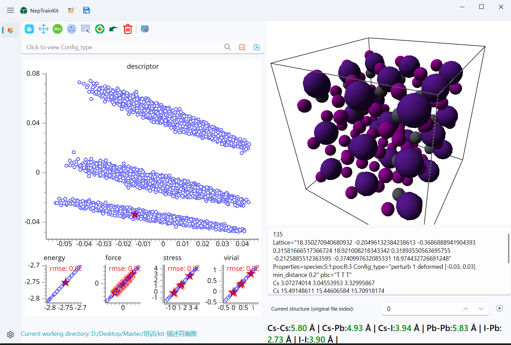
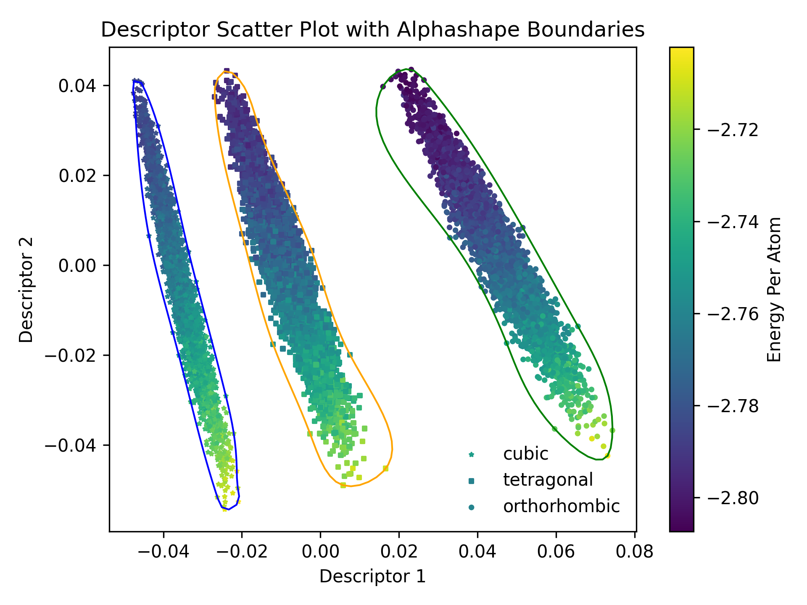

# 描述符分布绘图示例

想比较几类结构（例如 CsPbI3 的立方、四方和正交相）在描述符空间里的覆盖范围时，可以分别导出它们的描述符，
再用仓库提供的脚本画在同一张图上。本例最终得到一张带边界线的描述符散点图，颜色表示每原子能量。



## 1. 分别导出每类结构的描述符

在 `NEP 数据集查看` 中打开包含这些结构的数据，然后对每一类结构重复：

1. 选中这一类结构：可以用工具栏  `鼠标选择` 在描述符图上圈选，也可以用筛选栏按 `Config_type` 选中。
2. 点击工具栏  `导出结构描述符`。
3. 选择保存路径，例如 `cubic_descriptor.out`。

导出文件只包含**当前选中**的结构。每行对应一个结构：前两列是描述符图上的两个坐标；
数据中有能量时，第三列是每原子能量。没有选中任何结构时不会生成文件。

## 2. 配置并运行绘图脚本

下载 [plot_descriptor.py](https://github.com/aboys-cb/NepTrainKit/blob/master/tools/plot_descriptor.py)，
放在导出文件所在的目录，然后修改脚本开头的两项：

- `config`：每类结构一行，依次写描述符文件路径、图例名称和标记符号，例如
  `("./cubic_descriptor.out", "cubic", "*")`。
- `method`：边界线的画法。`alphashape` 需要先安装 `alphashape` 包；`dbscan` 需要先安装 `scikit-learn`。

脚本使用第三列给散点上色，所以导出的数据需要带能量。运行：

```bash
python plot_descriptor.py
```

结果保存为当前目录下的 `descriptor_scatter_plot.png`：



## 3. 怎么读这张图

- 不同类别的点云明显分开，说明描述符能区分这些结构；大面积重叠时，模型可能难以区分它们。
- 某一类只覆盖很小的区域，说明这类结构的采样还不够多样，可以回到 `构建数据集` 补充扰动或应变。
- 同一位置颜色差别很大，表示描述符相近但能量不同，值得在 `NEP 数据集查看` 中抽查这些结构。
