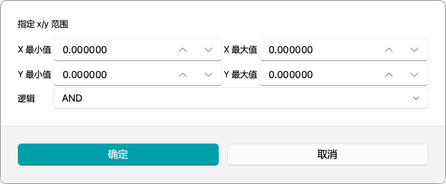
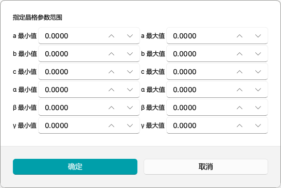
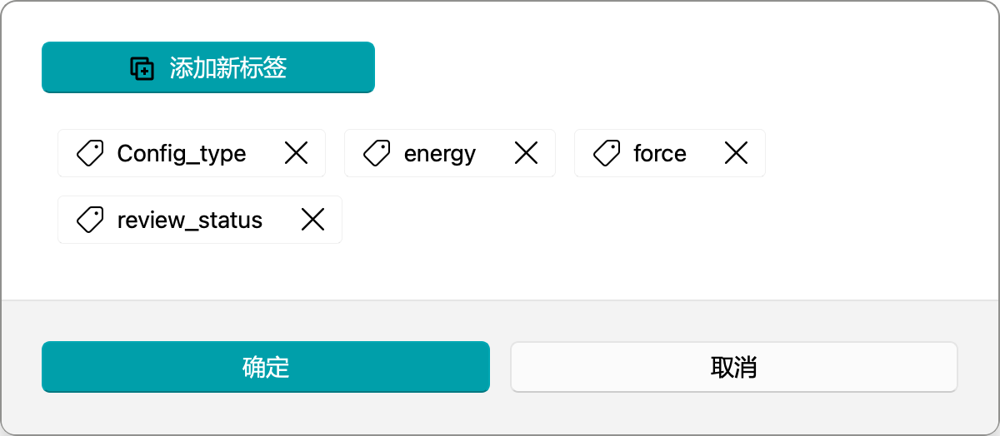
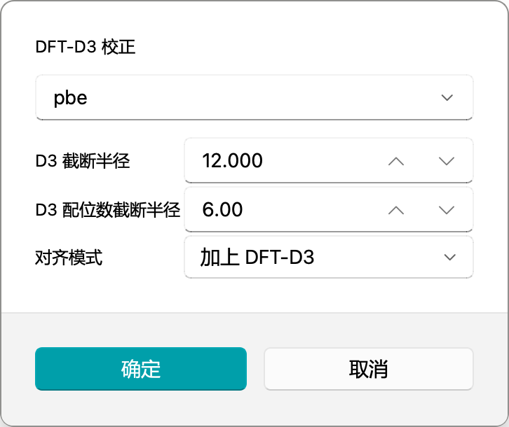
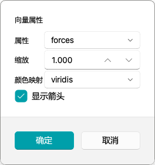
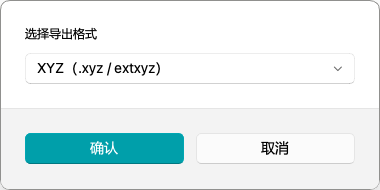
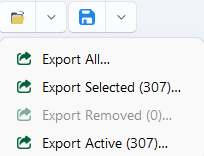
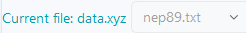
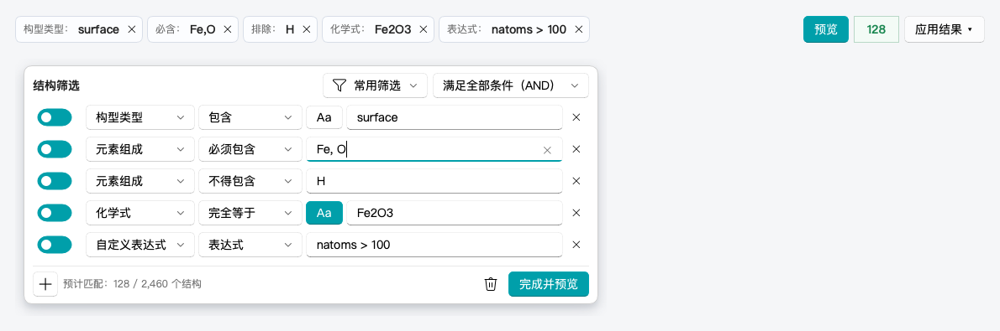
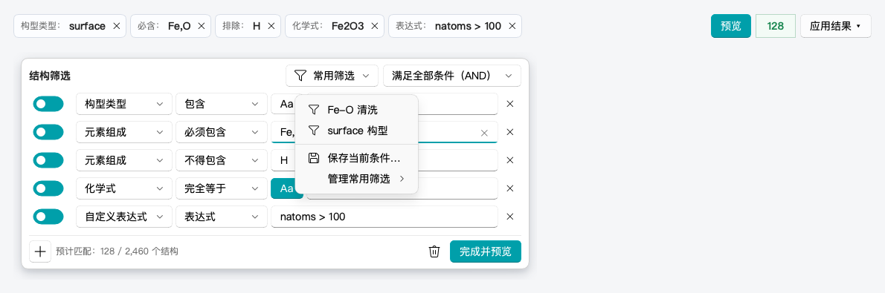

# NEP 数据集查看内容源

```{contents} 本页目录
:local:
:depth: 2
```

> 目标：按“按钮入口”组织说明。先看按钮，再看它会不会打开设置窗口、要填什么、执行后会发生什么。

<!-- display-overview-start -->
## 1. 界面总览

```{image} ../_static/image/generated/show_nep_overview.png
:alt: NEP 数据集查看界面总览
:class: docs-screenshot
```

- 左侧：误差散点主图区（descriptor / energy / force / pressure / potential energy 等子图）。
- 右侧：结构区（3D 结构、结构信息、最短键长、净力、索引与播放）。
- 底部：数据状态行 `原始 / 当前 / 删 / 选 / 坏`。
- 顶部：`打开` / `保存` 分裂按钮（菜单动作会随页面显示动态注入）。
<!-- display-overview-end -->

## 2. 按钮与弹窗绑定总表

<!-- display-main-tools-table-start -->
### 2.1 主图工具栏（左侧）

| 图标 | 按钮 | 是否打开设置 | 作用 |
|---|---|---|---|
|  | `重置视图` | 否 | 当前子图自动缩放回数据范围 |
|  | `平移视图` | 否（开关） | 切换平移交互 |
|  | `按索引选择` | 是 | 按编号或切片选择结构 |
|  | `按范围选择` | 是 | 按当前图的 x/y 范围选择结构 |
|  | `按晶格选择` | 是 | 按晶格参数范围选择结构 |
|  | `查找最大误差点` | 是 | 选择当前轴上误差最大的前 N 个结构 |
|  | `稀疏采样` | 是 | 用 FPS 做代表性采样 |
|  | `鼠标选择` | 否（开关） | 切换鼠标圈选/点选 |
|  | `查找非物理结构` | 否（仅进度） | 按近邻距离找疑似坏构型 |
|  | `检查净力` | 是 | 按净力阈值选择结构 |
|  | `反选` | 否 | 对当前活动结构反选 |
|  | `撤销选择` | 否 | 撤销最近一次选择变化 |
|  | `撤销删除` | 否 | 恢复最近一次删除 |
|  | `删除选中项` | 否 | 删除当前选中结构 |
|  | `编辑信息` | 是 | 批量编辑结构 metadata |
|  | `导出结构描述符` | 是（文件路径） | 导出当前结构描述符 |
|  | `能量基线平移` | 是 | 对能量基线做平移校正 |
|  | `DFT D3` | 是 | 配置并应用 DFT-D3 校正 |
|  | `训练集评估` | 否（打开评估页） | 查看整体组成、数据质量、标签、结构相和磁类型 |
<!-- display-main-tools-table-end -->

<!-- display-structure-tools-table-start -->
### 2.2 结构工具栏（右侧）

| 图标 | 按钮 | 是否打开设置 | 作用 |
|---|---|---|---|
|  | `正交视图` | 否（开关） | 切换正交视图 |
|  | `自动视图` | 否（开关） | 自动调整结构观察距离 |
|  | `显示键` | 否（开关） | 显示或隐藏键连线 |
|  | `显示箭头` | 是 | 显示力、磁矩或其他向量箭头 |
|  | `导出当前结构` | 是 | 导出当前结构 |
|  | `标记为坏点（reject）` | 否（开关） | 标记当前结构为 reject |
|  | `删除所有坏点` | 是（确认） | 删除所有 reject 结构 |
<!-- display-structure-tools-table-end -->

<!-- display-top-actions-start -->
### 2.3 顶部菜单动作

| 图标 | 菜单动作 | 是否打开设置 | 说明 |
|---|---|---|---|
|  | `打开文件…` | 是 | 选择 `xyz` / `extxyz` 等结构文件 |
|  | `打开文件夹…` | 是 | 选择目录（常用于训练输出目录或 `deepmd/npy`） |
|  | `导出全部…` 等导出菜单 | 是 | 先选导出格式，再选保存路径 |
<!-- display-top-actions-end -->

<!-- display-main-tools-start -->
## 3. 主图工具栏（按按钮查）

### 3.1 无弹窗按钮

<!-- display-basic-tools-start -->
| 按钮 | 行为 |
|---|---|
| `重置视图` | 当前子图自动缩放回数据范围 |
| `平移视图` | 切换平移交互 |
| `鼠标选择` | 切换多边形/点选交互 |
| `反选` | 对当前活动结构集合执行反选 |
| `删除选中项` | 删除选中结构并重绘 |
| `撤销选择` | 撤销最近一次选择变化；无可撤销时提示 `没有可撤销的选择操作！` |
| `撤销删除` | 撤销最近删除；无可撤销时提示 `没有可撤销的删除操作！` |
<!-- display-basic-tools-end -->

### 3.2 有弹窗按钮（参数与绑定写在一起）

#### A. `按索引选择`

<!-- display-select-index-start -->
- 输入控件：
  - 索引输入框：填写索引表达式
  - `使用原始索引`：默认勾选，按导入时的原始编号解释索引
- 索引表达式支持：
  - 单值：`3`, `-1`
  - 切片：`1:10`, `:100`, `::3`, `10:0:-1`
  - 多段：`1:10,20,30:40:2`（逗号或空白分隔）
- 执行结果：解析后选中结构；空表达式无效果。


<!-- display-select-index-end -->

#### B. `按范围选择`

<!-- display-select-range-start -->
- 输入控件：
  - `x 最小值 / x 最大值 / y 最小值 / y 最大值`：范围 `[-1e8, 1e8]`，6 位小数；
  - `逻辑关系`：`同时满足（AND）` / `任一满足（OR）`，默认同时满足。
- 默认值：打开时自动填充为当前子图数据极值。
- 执行结果：按坐标窗口筛选并选中结构。


<!-- display-select-range-end -->

#### C. `按晶格选择`

<!-- display-select-lattice-start -->
- 输入控件：晶格长度 `a / b / c` 与晶格角 `α / β / γ` 各自的最小值和最大值。
- 范围：`[0, 1e6]`，4 位小数。
- 默认值：当前活动结构的晶格参数范围。
- 边界：比较时带 `1e-4` 的容差，恰好落在边界上的结构也会被选中。


<!-- display-select-lattice-end -->

#### D. `查找最大误差点`

<!-- display-max-error-start -->
- 输入控件：`结构数`（整数 `N`）。
- 默认值：`10`；修改后会记住上次输入的数量。
- 执行结果：选中当前轴上误差最大的前 `N` 个结构。


<!-- display-max-error-end -->

#### E. `稀疏采样`

<!-- display-sparse-samples-start -->
- `选择策略`：
  - `全局 FPS（兼容模式）`：所有候选共享一个 FPS 预算；
  - `元素集合平衡 FPS`：按元素集合分组，每组先保留一个名额，其余名额按组大小平方根分配。
- `采样模式`：`固定数量（FPS）` / `R^2 停止（FPS）`。
- `样本上限`：`[0, 9999999]`。
- `最小距离`：`[0, 10]`，5 位小数；单位是当前描述符空间的距离单位。
- `R^2 阈值`：`[0, 1]`，仅在全局 `R^2 停止`模式生效。
- `描述符来源`：`降维后（PCA）` / `原始描述符`。
- `训练数据集`：可选 `.xyz` 或目录，用已有训练描述符初始化距离。
- `将当前选择作为区域`：只在当前选择内采样，并把最终代表点从选择中取消；剩余选中点可直接删除。
- `显示训练集叠加图`：填写训练数据集路径后，采样完成时显示训练集、当前数据和入选结构的 PCA 叠加图。
- 元素集合平衡模式固定使用原始描述符和固定数量采样，因此会锁定“采样模式”和“描述符来源”。
- 执行结果：更新选择集；平衡模式还会提示实际选择数量和覆盖的元素集合数。


<!-- display-sparse-samples-end -->

#### F. `查找非物理结构`（无参数弹窗，显示进度）

<!-- display-nonphysical-start -->
- 判定阈值：使用 `设置` 中的半径系数（默认 `0.7`）。两原子距离小于其共价半径之和乘以该系数时视为过近。
- 执行结果：扫描后选中疑似非物理结构。
<!-- display-nonphysical-end -->

#### G. `检查净力`

<!-- display-net-force-start -->
- 输入控件：`净力阈值`，即 `|ΣF|`。
- 范围：`[0, 1e6]`，10 位小数。
- 默认值：`1e-3`。
- 执行结果：选中超阈值结构，并显示统计消息。


<!-- display-net-force-end -->

#### H. `编辑信息`

<!-- display-edit-info-start -->
- 输入能力：
  - 新增标签（`key/value`）
  - 删除标签
  - 右键重命名标签
- 应用前确认：列出 `removed / renamed / added` 摘要。
- 执行结果：批量更新当前选中结构的结构信息（metadata）。


<!-- display-edit-info-end -->

#### I. `导出结构描述符`（路径选择）

<!-- display-export-descriptor-start -->
- 导出范围：只导出当前选中的结构；没有选中时提示后不生成文件。
- 默认文件名：`export_descriptor_data.out`。
- 文件格式：制表符分隔的文本，每行一个结构；前两列是描述符图上的坐标，数据中有能量时第三列是每原子能量。
<!-- display-export-descriptor-end -->

#### J. `能量基线平移`

<!-- display-energy-shift-start -->
- 预设区：`基线预设`，以及导入、导出和删除按钮。
- 参数区：`分组规则`、`对齐方式`、`最大迭代代数`、`种群大小`、`收敛容差`。
- 保存区：`保存为基线预设`和`预设名称`。
- 执行结果：后台拟合/应用基线平移并重绘。


<!-- display-energy-shift-end -->

#### K. `DFT D3`

<!-- display-dft-d3-start -->
- 输入控件：`交换-相关泛函`、`D3 截断半径`、`配位数截断半径`和`修正方式（加上/减去）`。
- 执行结果：后台应用 DFT-D3 修正并重绘。


<!-- display-dft-d3-end -->

#### L. `训练集评估`

<!-- display-training-audit-start -->
- 位置：主图工具栏中 `删除选中项` 后面的分隔线右侧。
- 评估范围：当前活动结构；已经删除的结构不参与。
- 概览：结构/原子统计、标签可用性、元素共现矩阵与精确元素集合。
- 证据：数据质量、局域化学、结构相和磁类型；耗时证据在后台计算。
- 结构回选：点击图表、表格或复核项后，可把真实结构索引送回 `NEP 数据集查看`。
- 报告：`导出 HTML 报告` 保存本次评估范围、指纹、证据、判据和限制。

完整操作顺序和识别原理见 [训练集评估](training-set-assessment.md)。
<!-- display-training-audit-end -->

#### M. `数据分布`

<!-- display-distributions-start -->
- 入口：点击工具栏 `训练集评估`，再切到「数据地图 → 数据分布」。工具栏不再单独提供分布按钮。
- 默认只需要选择 `字段 / 数值类型 / 分组方式 / 数据范围`。
- `选择方式 / 分箱数 / 辅助曲线 / 向量模长` 收入“高级选项”。
- `指标 / 数据系列` 与分布图联动；点击分箱会把对应结构选回 `NEP 数据集查看`。
- `参考值 / 预测值 / 误差` 只有在数据中确实存在对应标签或预测时才有结果。
<!-- display-distributions-end -->
<!-- display-main-tools-end -->

<!-- display-structure-tools-start -->
## 4. 结构工具栏（按按钮查）

### 4.1 相机与显示控制

| 按钮 | 行为 |
|---|---|
| `正交视图` | 在透视投影和正交投影之间切换 |
| `自动视图` | 切换结构时自动调整视角和观察距离 |
| `显示键` | 显示或隐藏原子之间的键 |

### 4.2 `显示箭头`

- 前提：结构绘图后端需要支持箭头。若提示 `当前结构绘图后端不支持箭头叠加。`，在 `设置` 中把绘图后端切换到 `VisPy`。
- 输入控件：
  - `属性`：只列出每个原子都有三维向量的属性（`N × 3`），例如力或磁矩
  - `缩放`：箭头长度系数，范围 `[0, 1000]`，默认 `1.0`
  - `颜色映射`：`viridis/magma/plasma/inferno/jet`
  - `显示箭头`：勾选显示，取消则清除



### 4.3 `导出当前结构`

- 第一步：选格式
  - `XYZ (.xyz / extxyz)`
  - `DeepMD NPY`
  - `DeepMD NPY (Mixed)`
- 选择 `DeepMD NPY` 时，再选择子目录按 `Config_type` 还是按化学式分组。选择 Mixed 时显示“虚拟原子填充”：`0` 按精确原子数分组，正整数按 dpdata 的 `atom_numb_pad` 规则向上补齐，使不同原子数可进入同一目录。XYZ 不显示这两个选项。
- 第二步：选路径
  - `xyz`：文件保存路径（默认 `structure_{index}.xyz`）
  - 两种 DeepMD NPY：目录保存路径



### 4.4 `标记为坏点（reject）` 与 `删除所有坏点`

- `标记为坏点（reject）`：只标记，不删除；主图上会高亮显示这些坏点。
- `删除所有坏点`：弹出确认框后，删除当前所有标记为坏点的结构，并清空坏点标记。


<!-- display-structure-tools-end -->

<!-- display-data-actions-start -->
## 5. 导入导出与 NEP 模型切换

### 5.1 导入

- `打开文件…`：选择 `xyz` / `extxyz` 等结构文件。
- `打开文件夹…`：选择训练输出目录或 `deepmd/npy` 目录。
- 拖拽：把文件或目录直接拖进窗口；不支持的格式会提示 `不支持的文件格式`。
- 已经打开数据时再导入新数据，软件会先确认是否替换。
- 加载在后台进行，加载时显示的进度提示可以取消加载。

### 5.2 导出菜单（顶部 `保存`）

| 菜单项 | 导出内容 |
| --- | --- |
| `导出全部…` | 当前打开的全部结构 |
| `导出已选择结构（N）…` | 当前选中的结构 |
| `导出已移除结构（N）…` | 已经删除的结构，便于留档 |
| `导出当前保留结构（N）…` | 删除后仍保留的结构，通常就是清洗后的数据集 |

- 括号里的 N 是当前数量；数量为 0 或数据仍在加载时，对应菜单项不可用。
- 点击后先选择导出格式，再选择保存路径。



### 5.3 NEP 模型切换（路径栏右侧下拉框）

- 可选模型：当前数据目录下文件名包含 `nep` 的 `*.txt` 文件，`nep.txt` 排在最前，
  其余按字母顺序；列表末尾还可以选择内置的 `nep89` 模型。
- 切换速度：切回已经计算过的模型时直接使用缓存结果；第一次切换到某个模型时会在后台重新计算。
- 切换后保留当前的选中结构和坏点标记。


<!-- display-data-actions-end -->

<!-- display-filter-start -->
## 6. 结构筛选栏

结构筛选栏可以同时使用配置类型、化学式、元素、原子条件和自定义表达式。条件默认取交集；经常重复使用的组合可以保存为“常用筛选”。



### 6.1 基本流程

1. 点击“筛选条件”打开编辑器。空筛选会自动出现第一行。
2. 在左下角点击“+”继续添加条件，例如“配置类型包含 `surface`”“必须包含 `Fe,O`”“不得包含 `H`”。
3. 在右上角选择“满足全部条件（AND）”或“满足任一条件（OR）”。
4. 点击“完成并预览”。图中的匹配高亮只用于预览，不会改变当前选择。
5. 确认匹配数量后，在“应用结果”中选择“替换当前选择”“加入当前选择”或“从当前选择中移除”。

修改条件后，旧匹配结果会显示为“结果已过期”。重新预览前不能继续应用旧结果。

编辑器右下角的垃圾篓按钮只清空筛选条件和匹配高亮，**不会清空当前选择**。清空选择位于“应用结果”菜单中。

### 6.2 条件含义

| 条件 | 含义 | 示例 |
|---|---|---|
| 配置类型 | 包含、完全等于、开头、结尾或正则匹配 | `surface` |
| 化学式 | 默认完全等于，也可选择包含或正则匹配 | `Fe2O3` |
| 必须包含元素 | 所列元素必须全部存在，允许还有其他元素 | `Fe,O` 可匹配 FeO 和 FeOC |
| 不得包含元素 | 所列元素必须全部不存在 | `H` 排除含 H 结构 |
| 只允许这些元素 | 结构中不能出现列表外元素 | `Fe,O` 可匹配 Fe、O 和 FeO |
| 自定义表达式 | 使用现有结构表达式引擎 | `natoms > 100` |
| 原子条件 | 选择目标元素、任一/所有原子、性质、比较符和阈值 | 任一 Fe 原子的磁矩模长小于 1 |

同一条配置类型或化学式条件可以用分号输入多个值，多个值之间取“任一匹配”。元素之间使用逗号或空格分隔，例如 `Fe, O`。

每行左侧的开关控制该条件是否参与筛选。关闭条件不会删除输入内容。配置类型和化学式右侧的 `Aa` 控制是否区分大小写；高亮时区分，未高亮时不区分。

非法正则、未知元素或错误表达式会直接标记对应条件，不会被当成“0 个匹配”，也不会意外匹配全部结构。

#### 不写表达式，筛选某种元素的磁矩

在条件类型中选择“原子条件”，将“目标元素”设为 `Fe`，“满足方式”设为“任一目标原子满足”，“原子性质”选“磁矩 · 模长”，比较选“小于”，阈值输入 `1`。此时只要一个 Fe 原子的磁矩模长小于 1，结构就会匹配；其他元素的小磁矩不会造成误匹配。

若要求所有 Fe 原子都满足，直接把“满足方式”切换为“所有目标原子满足”。两种方式均排除不含 Fe 的结构。选择“全部元素”时，对结构中的全部原子判断。

元素与数值属性选项来自当前数据集。常见磁矩、力、磁力和电荷显示易读名称，分量、模长以及参考值/预测值/误差可直接在性质列表选择。阈值支持负数和科学计数法。修改后会自动预览，仍需通过“应用结果”改变选择集。

原子条件继续使用已有表达式引擎和常用筛选格式，保存后重新打开仍可用控件编辑。切换到“自定义表达式”可以查看和修改生成的条件；包含复杂算术或多字段组合的表达式保留文本编辑方式。缺失字段、无效数值与稀疏原子行的处理仍遵循下文 `any/all` 的规则。

### 6.3 保存和复用常用筛选

如果经常清理同一类数据，可以保存整个条件组合。例如，一个常用组合可以是：

- 配置类型包含 `surface`
- 必须包含元素 `Fe,O`
- 不得包含元素 `H`
- 条件关系为“满足全部条件（AND）”

保存一次后，下次不需要逐行重填：

1. 先把条件、AND/OR 关系和 `Aa` 状态设置好。
2. 点击“常用筛选 → 保存当前条件…”。
3. 输入容易识别的名称，例如 `Fe-O surface`，然后点击“保存”。
4. 下次打开编辑器时，点击“常用筛选”，再直接点击该名称。



加载常用筛选会**替换编辑器里的当前条件**，随后更新预览；它不会自动执行“应用结果”，也不会改变当前选择。

保存内容包括：

- 每条条件的类型、输入值和启用状态
- 配置类型或化学式的匹配方式与 `Aa` 状态
- “满足全部条件（AND）”或“满足任一条件（OR）”

常用筛选保存在本机用户配置中，关闭并重新打开软件后仍可使用。它不会保存当前匹配结果、当前选择、数据集路径或 NEP 模型；保存的是筛选条件，不是自动处理流程。

需要维护已有条目时，进入“常用筛选 → 管理常用筛选”：

- “重命名”只修改名称，不改变条件。
- “删除”只删除保存的条目，不清空编辑器中的当前条件。
- 保存或重命名为已有名称时，软件会先询问是否覆盖。

如果条件中仍有空白行，软件不会保存。请补全该行，或用行尾的“×”先删除它。

(show-nep-expression)=
### 6.4 `表达式` 用法总览

- 目的：把“结构是否满足条件”写成一个布尔表达式，然后用搜索/勾选/反选按钮处理结果。
- 作用对象：仅当前 active structures；已经删除的结构不会参与表达式计算。
- 搜索按钮：高亮匹配结构。
- 勾选按钮：把匹配结构加入当前选择集。
- 反选按钮：把匹配结构从当前选择集中移除。
- 删除流程不变：通常是先用 expression 勾选，再点工具栏删除按钮。

#### 6.4.1 支持的运算符

- 逻辑运算：`&&`、`||`、`!`
- 逻辑关键字：`and`、`or`、`not`
- 比较运算：`>`、`>=`、`<`、`<=`、`==`、`!=`
- 算术运算：`+`、`-`、`*`、`/`
- 括号：`(`、`)`
- 原子条件聚合：`any(条件)`、`all(条件)`

示例：

- `natoms > 100`
- `has.H && natoms < 50`
- `(energy_per_atom < -3.0) && (force.norm > 10)`

#### 6.4.2 不支持的语法

- 除 `any(条件)`、`all(条件)` 外，不支持其他函数调用，例如 `len(structure)`、`mean(force)`、`min(...)`
- `any/all` 只接受一个条件参数，不支持嵌套调用或关键字参数
- 不支持固定原子索引：例如 `atom[3].force.x > 1`
- 不支持数字分量后缀：例如 `force.1`、`stress.3`
- 不支持字符串函数或正则函数

如果需要原子数，请直接使用 `natoms`。

#### 6.4.3 内置结构字段

下列字段不依赖当前图上显示哪一个子图，始终按当前 active structures 实时计算。

| 字段 | 含义 |
|---|---|
| `natoms` | 原子数 |
| `n_atoms` | `natoms` 的别名 |
| `volume` | 晶胞体积 |
| `a` `b` `c` | 晶格长度 |
| `alpha` `beta` `gamma` | 晶格角 |
| `spin_natoms` | 有磁矩原子数 |
| `energy` | 结构总能 |
| `energy_per_atom` | 每原子能量 |
| `has_energy` | 是否存在能量 |
| `has_forces` | 是否存在力 |
| `has_virial` | 是否存在 virial |
| `has_bec` | 是否存在 BEC |

示例：

- `natoms >= 128`
- `volume < 500`
- `a > 4.5 && c < 20`
- `energy_per_atom < -4.2`
- `has_forces && !has_bec`

#### 6.4.4 元素统计字段

元素字段按当前 active structures 里实际出现过的元素动态生成。

| 字段形式 | 含义 | 示例 |
|---|---|---|
| `count.<Elem>` | 指定元素个数 | `count.Fe >= 4` |
| `frac.<Elem>` | 指定元素占比 | `frac.Li > 0.5` |
| `has.<Elem>` | 是否包含指定元素 | `has.H && natoms < 50` |

补充说明：

- `<Elem>` 使用标准元素符号，例如 `H`、`O`、`Fe`、`Li`
- 区分元素符号，不区分前缀大小写的内部解析细节；文档和输入建议始终使用标准写法
- 如果当前 active structures 中没有该元素，表达式会报错

#### 6.4.5 动态数据字段

当前结果数据里存在什么字段，expression 模式就暴露什么字段。常见来源有两类：

- 结果数据集字段：如 `force`、`mforce`、`stress`、`virial`、`dipole`、`bec`
- 原子属性字段：写成 `atomic.<name>`，例如 `atomic.spin_vec`

这意味着：

- 如果当前数据里没有 `mforce`，补全中不会出现 `mforce`
- 如果手动输入了不存在的字段，例如 `mforce.ref.x > 1`，会直接报错

#### 6.4.6 后缀规则

##### A. 数据视图后缀

对于有参考值/预测值成对存在的数据集字段，可以追加：

- `.ref`：参考值
- `.pred`：预测值
- `.err`：误差，等价于 `pred - ref`

如果省略视图后缀，默认使用 `.ref`。

示例：

- `force.x > 10` 等价于 `force.ref.x > 10`
- `stress.err.norm > 2`
- `energy.pred > -4.0`

并不是所有字段都支持这三个后缀：

- `atomic.<name>` 不支持 `.ref/.pred/.err`
- 非成对数据字段也不支持 `.pred/.err`

##### B. 分量与范数后缀

向量或张量字段支持命名分量后缀，例如：

- 三维向量：`.x`、`.y`、`.z`
- 六分量张量：`.xx`、`.yy`、`.zz`、`.xy`、`.yz`、`.zx`
- 范数：`.norm`

示例：

- `force.x > 10`
- `mforce.norm > 5`
- `virial.xx < -20`
- `atomic.spin_vec.z > 0.2`

注意：

- 不支持 `.1/.2/.3` 这类数字分量写法
- 多分量字段若不写分量或 `.norm`，表达式会报错
- 标量字段可以直接比较，例如 `energy > -10`

#### 6.4.7 原子级字段如何聚合到结构级

表达式最终必须得到“每个结构是否命中”的结果，所以原子级数据会先聚合到结构级。

默认规则：

1. 先按你写的后缀取出分量或范数
2. 再在该结构内部做 `max(abs(values))`

不写 `any/all` 时，以上默认规则保持不变。例如 `atomic.spin.norm < 1` 要求结构内所有原子的磁矩模长都小于 1；磁矩模长为 `[0.5, 2.0]` 的结构不会命中。

因此：

- `force.x > 10` 的含义是“这个结构里是否存在原子满足 `max(abs(force_x)) > 10`”
- `force.norm > 10` 的含义是“这个结构里是否存在原子满足 `max(force_norm) > 10`”
- `atomic.spin_vec.y > 0.5` 的含义也是同样的结构级最大绝对值判断

结构级字段如 `natoms`、`volume`、`energy` 不需要额外聚合，直接逐结构比较。

##### 用 `any/all` 显式判断原子条件

- `any(atomic.spin.norm < 1)`：至少一个原子的磁矩模长小于 1 即命中。
- `all(atomic.spin.norm < 1)`：所有原子的磁矩模长都小于 1 才命中。
- `any(atomic.charge < 0)`：至少一个原子的电荷为负。
- `any(force.ref.norm > 10)`：至少一个原子的参考力模长大于 10。
- `all(force.err.norm < 0.2)`：每个原子的力误差向量模长都小于 0.2。
- `any(mforce.pred.z < -0.1)`：至少一个原子的预测磁力 z 分量小于 -0.1。

适用于当前数据中可用的所有数值型 `atomic.<name>` 属性，以及逐原子的结果字段（如 `force`、`mforce`、`bec`）。支持标量、向量/张量分量和 `.norm`；结果字段继续支持 `.ref/.pred/.err`，`atomic.<name>` 仍不支持这三种视图。力与磁力优先使用保留的逐原子数据，不受绘图是否使用结构汇总模式影响。

括号内先逐原子取值、运算和比较，再汇总布尔结果；分量和标量保留正负号，不会隐式取绝对值。例如 `any(atomic.spin.z < -1)` 可以筛出含负 z 分量的结构，而默认表达式仍按最大绝对值比较。

括号内支持现有比较、算术和逻辑运算。`any(atomic.spin.norm < 1 && force.norm > 10)` 要求同一个原子同时满足两个条件；`any(atomic.spin.norm < 1) && any(force.norm > 10)` 则允许两个不同原子分别满足。也可以与结构条件组合，例如 `natoms > 100 && any(atomic.spin.norm < 1)`。

`any/all` 内至少需要一个原子级字段。结构级字段可作为共同条件或阈值参与运算，但 `any(natoms > 100)` 不受支持，直接写 `natoms > 100` 即可。

缺少括号内引用字段或该字段没有原子行的结构，`any` 和 `all` 均不命中。引用值为 NaN/Inf 的原子按不满足条件处理：`any` 仍可由其他有效原子命中，`all` 不会通过。只含部分原子行的结果（如部分磁性原子的磁力）按实际提供的行判断；不能与无法对齐的其他原子字段放在同一个 `any/all` 内，遇到这种组合会报错。

##### 限定某种元素的原子

`atomic.element` 表示当前原子的元素符号，来自结构的原子种类。它只用于 `any/all` 内的 `==`、`!=` 比较，元素符号需要加单引号或双引号，并使用标准大小写（例如 `"Fe"`、`"O"`）。不支持 `.norm`、分量、`.ref/.pred/.err` 或算术运算；自动补全中可以找到 `atomic.element`。

- `any(atomic.element == "Fe" && atomic.spin.norm < 1)`：存在至少一个磁矩模长小于 1 的 Fe 原子。
- `has.Fe && all(atomic.element != "Fe" || atomic.spin.norm < 1)`：结构含 Fe，且所有 Fe 原子的磁矩模长都小于 1。
- `any(atomic.element == "O" && force.ref.norm > 10)`：存在至少一个参考力模长大于 10 的 O 原子。
- `all(atomic.element == "Fe")`：结构内每个原子都是 Fe。

`all` 仍然判断所有原子，不会把 `atomic.element == "Fe"` 自动当作元素范围。因此 `all(atomic.element == "Fe" && atomic.spin.norm < 1)` 要求结构全部由 Fe 组成，并且每个原子的磁矩模长小于 1。只约束 Fe 时，应使用上面的 `!= "Fe" || ...` 写法；加上 `has.Fe` 可排除不含 Fe 的结构。

`has.Fe && any(atomic.spin.norm < 1)` 仍是两个独立的结构条件，小磁矩可能来自 O 等其他元素。要保证同一个 Fe 原子满足 spin 条件，请将元素比较和 spin 比较放在同一个 `any` 内。

合法但数据中不存在的元素比较不会报错，例如 `any(atomic.element == "Ti")` 在不含 Ti 的结构上为假。缺失字段、NaN/Inf 和原子行对齐仍遵循上面的规则；即使使用元素条件，`all` 也不会忽略其他原子上的无效数值。仅含部分磁性原子行、无法与完整元素数组对齐的结果，不能与 `atomic.element` 放在同一个 `any/all` 内。

#### 6.4.8 常用表达式示例

##### 按结构大小筛选

- `natoms > 100`
- `natoms >= 32 && natoms <= 128`

##### 按晶格或体积筛选

- `volume < 1000`
- `a > 3 && b > 3 && c > 3`
- `gamma != 120`

##### 按元素组成筛选

- `count.O >= 4`
- `frac.Li > 0.25`
- `has.Fe && !has.H`

##### 按能量筛选

- `energy_per_atom < -3.5`
- `has_energy && energy > -500`

##### 按力、应力、virial 筛选

- `force.x > 10`
- `force.norm > 15`
- `force.err.norm > 0.2`
- `stress.xx > 5`
- `virial.err.norm > 1`

##### 按 atomic property 筛选

- `atomic.spin_vec.norm > 1.5`
- `atomic.spin_scalar > 0.1`

##### 组合条件

- `has.H && natoms < 50 && energy_per_atom < -2.5`
- `(count.Fe >= 2) && (force.norm > 8 || stress.norm > 2)`

#### 6.4.9 补全与右侧数量说明

expression 模式使用单独的动态补全，不和 `tag/formula/elements` 共用缓存。

补全来源包括：

- 内置结构字段，例如 `natoms`、`volume`
- 元素统计字段，例如 `count.Fe`、`frac.O`
- 当前数据集中真实存在的动态字段，例如 `force.ref.x`、`virial.ref.xx`
- 当前结构里真实存在的原子属性字段，例如 `atomic.spin_vec.y`

补全列表右侧的数字不是“本次搜索命中数”，而是“当前 active structures 中有多少个结构对这个候选字段是可用的/有意义的”：

- `natoms` 右侧数字通常等于当前 active structures 总数
- `count.Fe` 右侧数字表示包含 `Fe` 的结构数
- `has.H` 右侧数字表示包含 `H` 的结构数
- `force.ref.x` 右侧数字表示当前有 `force` 数据的结构数
- `atomic.spin_vec.y` 右侧数字表示当前有 `spin_vec` 原子属性的结构数

这和你实际输入完整表达式后的命中数量不是一回事。

#### 6.4.10 错误与排查

常见错误包括：

- `Unknown field in expression`
  - 字段不存在，或当前数据里没有这个字段
- `Unknown atomic field`
  - `atomic.<name>` 写错了，或当前结构没有该原子属性
- `Numeric component suffixes are not supported`
  - 使用了 `.1/.2/.3` 这类数字分量
- `Field 'xxx' requires an explicit component or '.norm'`
  - 多分量字段没有写具体分量
- `does not support value views`
  - 给不支持的字段写了 `.pred` 或 `.err`
- `Invalid expression syntax`
  - 语法不完整，例如 `force.x >`

#### 6.4.11 在结构筛选器中使用表达式

添加“自定义表达式”条件后，直接输入完整表达式。表达式仍由原有求值器执行，因此本节列出的字段、运算符和动态数据能力都可以继续使用。

表达式可以和其他条件组合。例如：

- 配置类型包含 `surface`
- 必须包含元素 `Fe,O`
- 自定义表达式 `natoms >= 64 && force.err.norm < 0.2`

三条条件在“满足全部条件”下会取交集。筛选器不会把表达式转换成另一套简化语法，因此不会丢失 `!=`、晶格角、布尔字段或动态字段。
<!-- display-filter-end -->

<!-- display-status-start -->
## 7. 状态与常见提示

- 数据状态：`原始 / 当前 / 删 / 选 / 坏`，分别是原始结构数、当前显示数、已删除数、已选中数和标记为坏点的数量；鼠标悬停时还会显示未选中数量。
- 结构状态：最短键长异常会红字提示；净力显示 `|ΣF|`。
- 播放按钮： / 。

| 提示文本 | 触发条件 |
|---|---|
| `不支持的文件格式` | 导入路径不支持 |
| `尚未加载 NEP 数据！` | 未加载数据即执行分析/导出 |
| `请先选择一些结构！` | 导出已选择结构时没有选中任何结构 |
| `没有可导出的保留结构。` | 导出当前保留结构时数量为 0 |
| `没有可导出的已移除结构。` | 导出已移除结构时数量为 0 |
| `没有可撤销的删除操作！` | 无可撤销删除 |
| `没有可用的矢量数据` | 箭头所需向量属性不存在 |
| `当前结构绘图后端不支持箭头叠加。` | 当前结构绘图后端不支持箭头，可在 `设置` 中切换到 `VisPy` |
| `Invalid regex pattern.` | `Config_type` 或 `化学式` 模式输入了非法正则 |
| `未知元素符号：Xx。请使用标准大小写，例如 'Fe'。` | `元素` 模式输入了未知元素 |
| `Unknown field in expression: xxx` | `表达式` 使用了不存在的字段 |
| `Numeric component suffixes are not supported in expressions.` | `表达式` 使用了 `.1/.2/.3` 这类数字分量 |
| `表达式包含不支持的语法。` | `表达式` 含有不支持的语法 |
| `表达式语法无效。` | `表达式` 语法不完整或无法解析 |
<!-- display-status-end -->

## 相关入口

- 功能概览页：[`NEP-dataset-display.md`](NEP-dataset-display.md)
- 示例页：[`../example/NEP-display.md`](../example/NEP-display.md)
